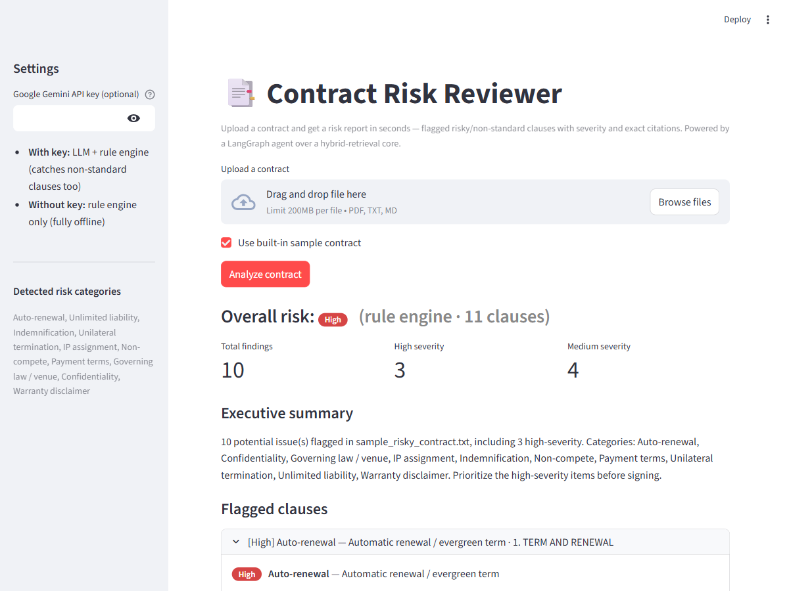

# 📑 Contract Risk Reviewer

[](https://github.com/Karthik0809/contract-risk-reviewer/actions/workflows/ci.yml)


An **agentic contract-review assistant**. Upload a contract and get a **risk report in seconds** — every risky or non-standard clause flagged with a **severity**, a plain-English rationale, a suggested redline, and the **exact cited text** it's based on.

The output is a *risk report, not a chatbot answer*. It's aimed at the people who actually review contracts by hand: small businesses and freelancers reviewing client paper, and lean legal/procurement teams.



## What it does

1. **Ingest** a PDF/TXT contract.
2. **Extract clauses** — split the contract into logical sections.
3. **Check risks** — a deterministic rule catalog *plus* an optional Gemini pass that catches non-standard clauses the rules miss.
4. **Report** — a typed `RiskReport`: overall risk rollup, executive summary, and per-clause findings with verbatim citations, **page/section anchors** (e.g. *p. 4 · §7*), and a **side-by-side redline** (current clause vs suggested change).

Runs **fully offline** with the rule engine (no API key needed). Add a Gemini key to enable the LLM pass. Reports export to **PDF, Word (DOCX), or JSON**.

## Agent pipeline

```
extract_clauses ──▶ rule_check ──▶ llm_check ──▶ build_report
```

Built with **LangGraph** ([`contract_agent.py`](contract_agent.py)); falls back to an equivalent linear run if LangGraph isn't installed. Every finding is validated against a **Pydantic schema** ([`contract_schema.py`](contract_schema.py)), so the report is always well-formed.

## Detected risk categories

Auto-renewal · Unlimited liability · Indemnification · Unilateral termination · IP assignment · Non-compete · Payment terms · Governing law / venue · Confidentiality · Warranty disclaimer

See [`risk_rules.py`](risk_rules.py) for the full catalog and patterns.

## Quickstart

```bash
pip install -r requirements.txt
streamlit run streamlit_app.py
```

Upload a contract, or tick **"Use built-in sample contract"** for an instant demo. Optionally paste a Google Gemini API key in the sidebar to enable the LLM pass.

Or run it in Docker:

```bash
docker build -t contract-risk-reviewer . && docker run -p 7860:7860 contract-risk-reviewer
```

## Evaluation

The reviewer is evaluated two ways: a **curated set** for precision (with hard negatives) and the **real-world CUAD corpus** for an honest recall number.

### Real-world recall — CUAD (510 real contracts)

Scoring only your own hand-written clauses is circular. So the reviewer is also evaluated against **[CUAD](https://www.atticusprojectai.org/cuad)** — 510 real commercial contracts with expert clause annotations (The Atticus Project, CC BY 4.0). Six of our categories map faithfully onto CUAD's; we measure recall on those:

```bash
python eval/run_cuad_eval.py --split full   # downloads ~18 MB, runs offline after that
```

Rule-engine baseline ([`eval/cuad_results.json`](eval/cuad_results.json)):

| Category | Recall | Gold clauses | CUAD match |
|---|---|---|---|
| Non-compete | 42% | 119 | good |
| Auto-renewal | 38% | 176 | good |
| Unilateral termination | 31% | 183 | excellent |
| IP assignment | 27% | 124 | excellent |
| Governing law / venue | 24% | 437 | partial (we only flag *exclusive* venue) |
| Unlimited liability | 0% | 111 | excellent |
| **Overall** | **26.9%** | **1,150** | — |

**This is the honest headline, not a flaw to hide.** The deterministic rules are precision-first — near-100% precision on curated clauses — so on real, diversely-worded paper they form a **high-precision / low-recall baseline**. That ~27% is exactly the gap the optional **LLM extraction pass exists to close**; run `--llm` to measure the lift on the same contracts. (Indemnification, payment terms, confidentiality, and warranty disclaimer have no faithful CUAD category, so they're reported but not scored.)

### Precision — curated set with hard negatives

A labeled set ([`eval/labeled_contracts.json`](eval/labeled_contracts.json)) of **53 clauses**: varied-phrasing positives, **hard negatives** (clauses that look risky lexically but are standard — e.g. *capped* liability, *mutual for-cause* termination, *time-bound* confidentiality, *Net 30* — and must **not** be flagged), and clean boilerplate. A reproducible harness measures detection rate:

```bash
python eval/run_eval.py          # rule engine only (offline, reproducible)
python eval/run_eval.py --llm    # also run the Gemini pass (needs GOOGLE_API_KEY)
```

Current rule-engine results on the labeled set:

| Metric | Value |
|---|---|
| Detection rate (recall) | **100%** |
| Precision | **100%** |
| F1 | **1.00** |
| Clean-clause false-positive rate | **0%** |
| Hard-negative false-positive rate (n=16) | **0%** |

The eval reports **per-category recall** and gates CI (`--min-recall`, `--min-precision`) so a rule change that regresses detection or starts firing on hard negatives fails the build. The hard negatives are what keep the rules honest — they're why precision is a real number, not just an artifact of easy positives.

## Tests

```bash
python -m pytest test_contract_reviewer.py -q
```

## Project layout

| File | Role |
|---|---|
| `contract_schema.py` | Pydantic models: `Severity`, `RiskFinding`, `Clause`, `RiskReport` |
| `risk_rules.py` | Deterministic risk catalog (offline baseline + LLM taxonomy) |
| `contract_agent.py` | LangGraph agent: extract → rule check → LLM check → report (+ page anchors) |
| `streamlit_app.py` | Upload → analyze → color-coded report with redline + PDF/DOCX/JSON export |
| `report_export.py` | Renders a `RiskReport` to a branded PDF or Word document |
| `eval/run_eval.py` | Curated-set harness (precision, hard negatives, CI gate) |
| `eval/run_cuad_eval.py` | Real-world recall harness against the CUAD corpus (510 contracts) |
| `.github/workflows/ci.yml` | Runs tests + eval gate on Python 3.10–3.12 |
| `document_processor.py`, `rag_engine.py`, `llm_interface.py` | Ingestion / hybrid retrieval / Gemini core |

## Ask-anything retrieval (bonus)

The bundled hybrid retrieval stack (FAISS + BM25 + TF-IDF + reranking) can also answer free-form questions about a contract (*"what's the notice period?"*) via the optional Gradio interface:

```bash
python run.py
```

## License

See [LICENSE](LICENSE).
